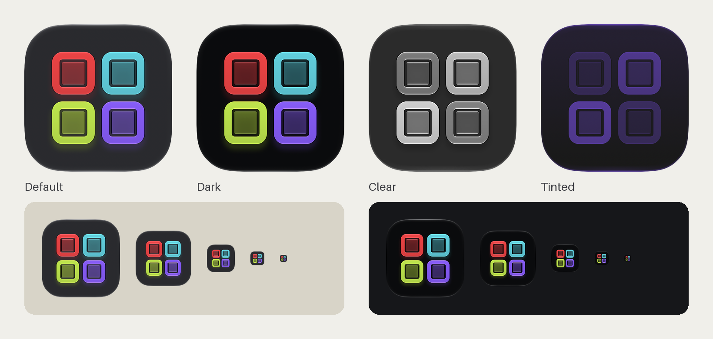

# App icon

auto-dj's app icon, as an Icon Composer file for the layered Liquid Glass icons in macOS 26 and later. `AppIcon.icon`
opens in Icon Composer as it is.



The preview is rendered by Icon Composer's own renderer (`ictool`), so it shows the real glass.

## Design

The four hot cue pads auto-dj places on every track, A to D (IN, BRIDGE, DROP, OUT,
[ADR 0001](../../docs/decisions/0001-cue-template.md)), lit in Rekordbox's pad colours on a dark deck: the docs'
[pad mark](../../docs/assets/pad-mark.svg) as an app icon. The colours are the docs' `--ad-pad-*` and `--ad-deck` values
(`docs/stylesheets/extra.css`). Each pad is its own group, so the system gives each one its own glass, highlights and a
shadow in its own colour, which reads as the pad's glow. In each group, back to front:

| Group    | Layers                        | Colour    |
| -------- | ----------------------------- | --------- |
| A IN     | `1-a-face.svg`, `1-a-rim.svg` | `#FF2D3D` |
| B BRIDGE | `2-b-face.svg`, `2-b-rim.svg` | `#19D3E0` |
| C DROP   | `3-c-face.svg`, `3-c-rim.svg` | `#B5E61D` |
| D OUT    | `4-d-face.svg`, `4-d-rim.svg` | `#8F5BFF` |

The rim is the pad's colour. The face inside it is the same colour at 45% (38% in dark mode), so the pad looks lit
through its glass. The background is `#2A2B2F`, and `#0B0C0E` in dark mode. Clear and tinted are left to the system,
which derives them from the default appearance.

It follows the [app icon guidelines](https://developer.apple.com/design/human-interface-guidelines/app-icons):

- A 1024 pt canvas, with every layer a full-canvas SVG so the layers stay aligned when they're imported.
- Opaque white artwork with no background, mask, blur, shadow, highlight or opacity. Icon Composer adds those, and sets
  each layer's colour.
- Vector art only, with each rim outlined into a filled shape.
- The pad grid is centred well inside the mask, so nothing is cropped.
- Up to four groups. This uses all four, one per pad.

## Files

- `AppIcon.icon`: the Icon Composer file. `icon.json` holds the background, the colours and the glass settings, and
  `Assets/` holds the layers.
- `generate.py`: regenerates the layer SVGs from their geometry. From the repository root:

  ```sh
  uv run --no-project --with skia-pathops --with fonttools \
    python3 design/app-icon/generate.py design/app-icon/AppIcon.icon/Assets
  ```

- `preview.py`: renders `preview.png` with `ictool` (needs Xcode 26 or later):

  ```sh
  uv run --no-project --with pillow python3 design/app-icon/preview.py
  ```

- `preview.png`: the preview above.

## In the app

`project.yml` adds `AppIcon.icon` to the AutoDJ target as a resource (an `.icon` is a bundle, so `fileTypes` treats it
as one file), and `ASSETCATALOG_COMPILER_APPICON_NAME` is `AppIcon`, the file's name. Xcode compiles it into the app's
`Assets.car` and also writes a flat `AppIcon.icns`, which macOS 15 (the app's minimum) shows. Run `mise run gen` after
renaming or moving it.
