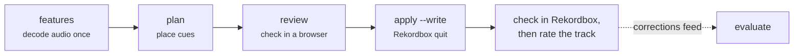

# Cueing your library

Cueing is a four-step loop. Everything before `apply --write` is read-only, so you can run it with Rekordbox open.



## 1. Decode the audio

```sh
auto-dj features
```

ffmpeg decodes each track once and auto-dj stores per-frame band energies in `~/.cache/auto-dj/features/`. The rules use
the sub band (30–120 Hz) to find where the bass is. Run it again after adding tracks; cached files are skipped.

## 2. Plan the cues

```sh
auto-dj plan
```

auto-dj picks the tracks to cue by their [state](../cues/track-states.md): by default Mixed In Key / `CUE(Auto)` tracks
(`mik`) and tracks with no hot cues (`nohot`). It never plans a rated or hand-cued track. The plan goes to
`~/.cache/auto-dj/plan.json`, and the summary counts anything worth a look:

```text
--8<-- "demo/plan.txt"
```

## 3. Review it

```sh
auto-dj review    # -> ~/.cache/auto-dj/review.html
```

The review page draws each planned track as an energy strip with its phrases and cue markers. Filter it to the tracks
with no bridge or no bass swap, the two cues most worth checking by ear.

## 4. Write it

Quit Rekordbox, then:

```sh
auto-dj apply             # dry run against a copy of master.db
auto-dj apply --write     # backs up master.db, writes, verifies
```

`--only "Loleatta" "Trust Me"` limits a write to titles containing those strings. A track whose cues changed after the
plan was made is skipped; re-run `plan` for it.

Open Rekordbox and spot-check, then **re-export or sync your USB sticks**: Rekordbox reads cues from its database, and
the device copies only pick them up on export.

## 5. Rate what you've checked

Once you've checked a track (and fixed anything you disagree with), give it a star rating. A rated track counts as
hand-cued: auto-dj never touches it again, and [`evaluate`](../commands/evaluate.md) scores future rule changes against
it. That is how the rules learn your taste.

To re-cue tracks after a rule change, plan the ones auto-dj cued before and haven't been rated yet:

```sh
auto-dj plan --categories auto
```

Your own E/F/G notes on those tracks are kept.
